# Cyclops Pumpkin Robot: An AI-Powered Moving Eye on the RDK X5


A pumpkin robot with one moving eye, a quiet voice, and a habit of watching whoever walks by.

## Project overview

The Cyclops Pumpkin Robot is a 3D-printed pumpkin with a single moving eye on a round display. A USB camera and the RDK X5's BPU detect people in real time: someone far away gets a whispered "I see you...", and when a face comes up close the eye twitches, slams shut and opens again as a moving reptile eye while LEDs pulse with a ghost laugh and a relay sends mist drifting out of the pumpkin. Camera, AI, eye animation, sound, lights and relay all run on the RDK X5, fully offline.

## Links

- Repository: https://github.com/CodersCafeTech/Cyclops-Pumpkin
- Demo video: https://youtube.com/shorts/P1_9KhJj4cU
- Creator: CodersCafeTech
- Creator profile: https://github.com/CodersCafeTech
- Source license: [MIT](LICENSE)

## The Pumpkin That Looked Back

Every jack-o'-lantern ends up the same way: two triangle eyes, a crooked grin, and a face that stares out all night without seeing a thing. This October, we wanted ours to see.

So we gave it a moving eye. Not a painted one or a glowing hole, but a living eye that drifts from side to side, blinks when it feels like it, and quietly takes in the room.

Then we gave it a reason to stare. From across the room, it notices you and breathes a soft "I see you...". Come closer, lean in for a better look, and the pumpkin stops pretending. It laughs. The light inside it flares yellow. The eye snaps shut, and when it opens again, it is no longer anything human.

It all began with a 3D-printed pumpkin and three things on our desk: a D-Robotics RDK X5, a Waveshare 1.28-inch round display and a USB webcam from the parts drawer. Over two days, one part at a time, they became the Cyclops Pumpkin Robot:

- **Someone in the distance?** The camera spots them, and a ghostly voice breathes "I see you..." while the moving eye keeps glancing around as if nothing happened.
- **A face up close?** A ghost laugh erupts, five LEDs inside the pumpkin flare yellow with every "ha", the eye twitches, slams shut and opens again as a glowing reptile eye with a slit pupil, and a relay switches on a humidifier, and mist starts drifting out of the pumpkin like smoke.
- **They back away?** Four seconds later the eye blinks back to normal and the pumpkin goes quiet, waiting for the next one.

Everything runs on the X5 itself, with no cloud and no servers. What follows is the story of how it came together, one part at a time, including every part that refused to work the first time.

## Demo

The best way to meet the Cyclops is to watch its eye move as it notices someone.

- Demo video: https://youtube.com/shorts/P1_9KhJj4cU
- Source code: https://github.com/CodersCafeTech/Cyclops-Pumpkin

## Features

- **Two-stage reaction.** A whisper for someone in the distance, a full transformation for a face up close.
- **Real-time detection on the BPU.** Bodies, heads and faces from one model pass, about 13 ms per frame.
- **A moving eye.** It glances side to side, blinks, breathes its pupil and transforms on cue.
- **A hand-drawn eye.** Four phases drawn in code with NumPy and played at 20 frames a second on a 1.28-inch round display.
- **Light that follows the laugh.** Five WS2812B LEDs driven from SPI1, pulsing with the laugh's loudness.
- **Smoke on cue.** A relay switches a humidifier on during the transformation, so mist drifts out like smoke, and off when the eye goes back to normal.
- **Fully offline.** Camera, AI, eye, sound and lights all run on the RDK X5.
- **Tunable from the command line.** Detection, timing, sound and LED settings are all options.

## Bill of Materials

### Hardware components

| Part | Qty | What it does |
| --- | --- | --- |
| [D-Robotics RDK X5](https://d-robotics.cc/rdkx5) | 1 | The brain: runs the camera, BPU detection, eye animation, sound and LEDs |
| [Waveshare 1.28" round LCD module](https://www.waveshare.com/wiki/1.28inch_LCD_Module) (GC9A01, 240x240) | 1 | The moving eye |
| USB webcam (640x480 MJPG) | 1 | Watches the street |
| WS2812B LED strip, 5 LEDs | 1 | Yellow glow that pulses with the laugh |
| 5 V power supply for the LEDs | 1 | Powers the strip (GND shared with the board) |
| 1-channel relay module (active-low) | 1 | Switches the humidifier on for the smoke effect |
| Humidifier | 1 | Makes the mist that drifts out like smoke |
| Speaker or amplifier with a 3.5 mm plug | 1 | Plays the voice and the laugh |
| Jumper wires | ~17 | Keep the SPI wires short |
| 3D-printed pumpkin | 1 | The cyclops |

### Software and services

- RDK X5 Ubuntu 22.04 image with Python 3.10
- `hobot_dnn` (BPU inference), `Hobot.GPIO`, `spidev`
- OpenCV, NumPy (Pillow only for `pumpkin_eye.py --preview`)
- The multitask body/head/face/hand model from TROS `mono2d_body_detection` (already on the board)
- PulseAudio (`paplay`, with an ALSA `aplay` fallback) and `ffmpeg`/`ffprobe`
- Sound effects: ["i see you" from Quick Sounds](https://quicksounds.com/sound/31210/i-see-you) and ["Ghost Laughing" by ProSounds](https://www.youtube.com/watch?v=ujSx5LyEYBU)

### Tools

- A 3D printer for the pumpkin
- A computer or SSH session to the board

## System Architecture

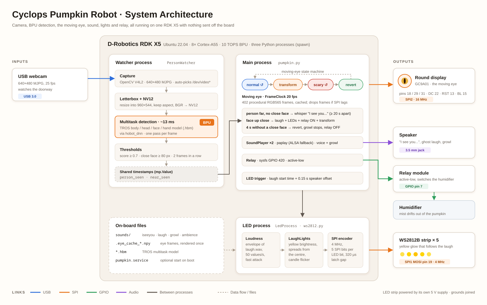

The watcher process owns the camera and the BPU and answers two questions: is someone out there, and is a face close. The main process turns those answers into a show. It picks the eye phase, starts the sounds and switches the humidifier through the relay, while the LED process keeps the strip in time with the laugh.

## The Brain: D-Robotics RDK X5

A pumpkin that sees, thinks, talks and glows usually means a pile of boards: a microcontroller for the LEDs, a Pi for the display, a phone or a cloud API for the AI. We wanted one board to do all of it, and that is exactly the job the RDK X5 was built for. D-Robotics calls it an all-in-one kit "for robotics and edge intelligence", and by the end of this build we had used almost every part of that promise.

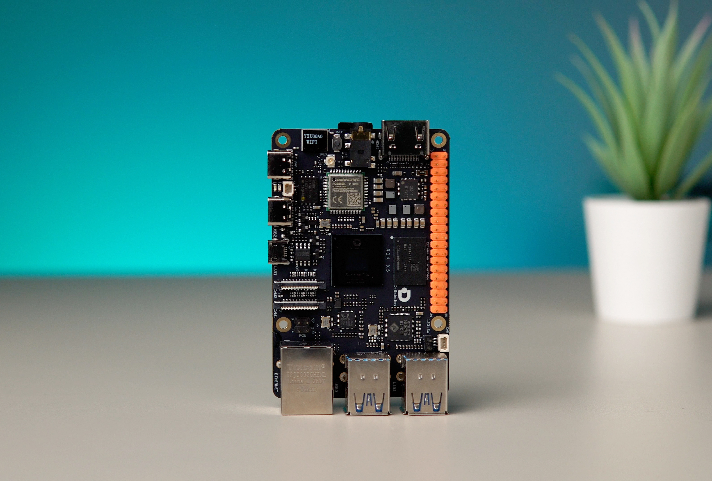

| Spec | RDK X5 | What the pumpkin uses it for |
| --- | --- | --- |
| SoC | Sunrise X5 | Everything below |
| AI accelerator | 10 TOPS BPU | Real-time person and face detection, ~13 ms per frame |
| CPU | 8x Arm Cortex-A55 @ 1.5 GHz | Eye rendering, sound, LEDs and detection in parallel processes |
| Memory | 4 GB / 8 GB LPDDR4 | Holds 402 pre-rendered eye frames (~46 MB) |
| USB | USB 3.0 host | The USB webcam |
| Audio | 3.5 mm headphone jack | Voice and laugh straight to a speaker |
| 40-pin header | SPI and GPIO | Display on SPI2, LEDs on SPI1, relay and display control on GPIO |
| OS | Ubuntu 22.04 | Python, OpenCV, PulseAudio, systemd, all on the board |

### 1. The 10 TOPS BPU: the reason the scare lands on time

The heart of the X5 is its BPU, a Brain Processing Unit built only to run neural networks. It works next to the CPU, not on it, so the pumpkin can think about faces while the CPU keeps the eye moving.

The best surprise came before we wrote a line of AI code. Digging through the board, we found D-Robotics' robotics stack, TROS, already installed, and inside it a compiled model called `multitask_body_head_face_hand_kps_960x544.hbm`. One pass of that model finds bodies, heads, faces and hands all at once. We loaded it straight from Python with `hobot_dnn`, fed it a street photo that shipped with it, and it found all five faces. The first run took 18 ms; after that it settled at about 13 ms per frame.

That speed shaped the whole design. Because one pass returns both bodies and faces, the pumpkin can tell "someone is out there" (a body or a head, even far away or turned sideways) from "someone is right here" (a face big enough in the frame). That split became the two-stage scare.

### 2. Eight Cortex-A55 cores: three jobs, no waiting

The eye has to keep moving while the camera keeps watching and the LEDs keep pulsing. On a single core one of those would always be waiting. The X5's eight Cortex-A55 cores at 1.5 GHz let us give each job its own Python process: one draws the eye, one runs the camera and the BPU, one drives the LEDs.

We did not start that way. We started with threads, and the camera never opened (Chapter 4 tells that story). The fix only worked because the cores were there to spare. The same cores draw every eye frame from scratch with NumPy, veins and all, once, on the first run.

### 3. The 40-pin header: SPI, GPIO and device-tree overlays

The header is where the X5 meets the pumpkin, and we leaned on three of its talents:

- **SPI2 for the eye.** The round display gets up to 115,200 bytes per frame over SPI2, whose pads run at 3.3 V.
- **SPI1 for the LEDs.** WS2812B LEDs need pulses timed to fractions of a microsecond, and Linux cannot wiggle a pin that precisely. SPI hardware can, so we turned SPI1's data line into an LED signal generator.
- **GPIO for the rest.** Display reset, data/command and backlight, plus the relay for the humidifier.

SPI2 was switched off from the factory. On many boards that would mean rebuilding the kernel. On the X5 it took a three-line device-tree overlay, one line in `/boot/config.txt` and a reboot.

### 4. Onboard audio: the voice needs no extra hardware

The X5 has a 3.5 mm headphone jack. We plugged a speaker straight in and played sounds through PulseAudio, two at a time when we needed the laugh and the growl to overlap. When no desktop session is running, the same code plays straight to the jack through ALSA. No USB sound card, no amplifier board on the header.

### 5. USB 3.0: eyes from the parts drawer

The webcam was the cheapest one we had. It appeared as `/dev/video0` the moment it was plugged into one of the four USB 3.0 ports, and OpenCV read it at 640x480, 25 frames a second. The code picks the first `/dev/video*` that delivers frames, so you rarely need `--camera`.

### 6. Ubuntu 22.04: a real Linux toolbox

Because the X5 runs full Ubuntu, every tool we reached for was one `import` away: OpenCV, NumPy, Pillow, `spidev`, `ffmpeg`. When something misbehaved, we could debug it the way you debug any Linux machine, with logs, `dmesg` and a terminal. And when it worked, systemd could start it on boot.

## How We Built It

We made one rule before touching a wire: bring up one part at a time, test it alone until it behaves, and only then let it join the rest. Every chapter below follows that rule, and every part left a small test script behind, so you can retrace our steps and know exactly which part broke when something goes wrong.

### Chapter 1: An eye with no driver

We started with the moving eye, because without it there is no cyclops.

The round display uses a GC9A01 controller, so our first move was to look for a driver. The X5's kernel had none: no fbtft, no tinydrm, no ready-made overlay, and pip had no package either. Waveshare's own Python demo was close, but it is built on `gpiozero`, which only speaks Raspberry Pi. So we wrote our own. We took Waveshare's initialisation sequence, checked it byte for byte against their `LCD_1inch28.py`, and rebuilt it on top of `spidev` and `Hobot.GPIO`: `gc9a01.py`.

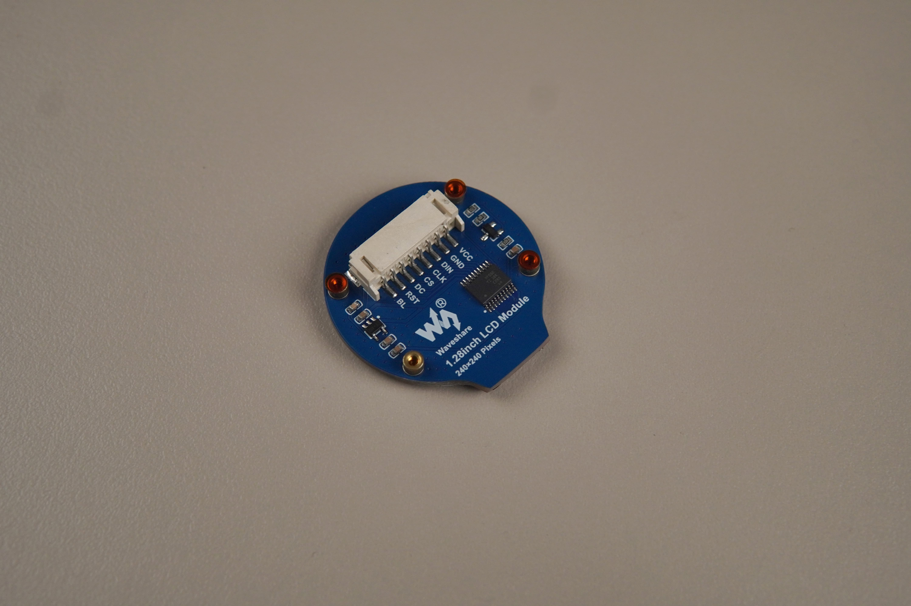

The first test was a spinning rainbow ring on SPI1. The code ran happily at 15 frames a second. The screen stayed completely black.

To split the problem in half, we blinked the backlight pin on and off for twenty seconds. It blinked, so power and GPIO were fine and the fault was in the data. Reading the X5's pin table closely gave it away: header pin 24 is SPI1's *second* chip select, which Linux calls `/dev/spidev1.1`, not `/dev/spidev1.0`. One number changed, and the rainbow appeared.

It was not perfect yet. Every few seconds the image glitched, and slowing the clock only helped so much. The real cause was in the device tree: the X5 leaves SPI1's pads in 1.8 V mode at the weakest drive strength, 3 mA, even though the header is 3.3 V. We wrote two overlays to fix that, one switching the pads to 3.3 V and one raising the drive strength; switching the pads to 3.3 V did not take effect. So we moved the display to SPI2 instead, whose pads are 3.3 V with 9 mA drive: MOSI on pin 18, SCLK on pin 29, CS on pin 31, `/dev/spidev2.0`. The glitches stopped.

SPI2 runs at 16 MHz and tops out at about 14 full frames a second, so the driver got smarter too:

- it sends only what changed since the last frame, one rectangle per band of 16 rows, which also skips the round panel's black corners;
- it resends the whole frame every 2 seconds, so a corrupted pixel can never stick;
- it re-sends the colour-format, orientation and inversion registers before every frame, so a noise hit that flips one of them lasts a single frame.

```bash
python3 src/pumpkin_eye.py --mode normal   # display test: the innocent eye
```

### Chapter 2: Drawing a monster

A rainbow ring is not scary. The eye needed to be a normal, almost friendly eye that could turn into something from a dinosaur film.

We chose not to use video files at all. Every frame is drawn in code with NumPy in `pumpkin_eye.py`: a shaded white sclera with faint veins, an iris built from hundreds of radial fibres, a round pupil, two glints of light and eyelids. We made the eyelids pumpkin-orange so they blend into the printed shell, and the eye looks like it grew there.

The monster is the same drawing with every dial turned. The sclera floods blood-red and the veins creep in from the edges. The iris swells and burns yellow to orange with a glow around it. The round pupil narrows into a pointed vertical slit, like a reptile's. The lids drop into an angry squint.

Our first version was one long loop. Watching it on the pumpkin, we realised the scare only works if the eye stays innocent until the right moment, so we split it into separate pieces the program can switch between. Each phase is written as a timeline at 10 steps a second, and an in-between frame is added after every step, so it plays at 20 frames a second:

| Phase | Length | What happens |
| --- | --- | --- |
| `normal` | 7 s (140 frames), loops | Blue-hazel eye glancing around, blinking, its pupil slowly breathing |
| `transform` | 4.1 s (82 frames), once | Twitching, the pupil blowing wide, the lids slamming shut with a red flash, the beast opening its eye |
| `scary` | 8 s (160 frames), loops | The reptile eye scanning side to side, then "noticing you" with a wider slit and a brighter glow |
| `revert` | 1 s (20 frames), once | A slow blink back to normal |

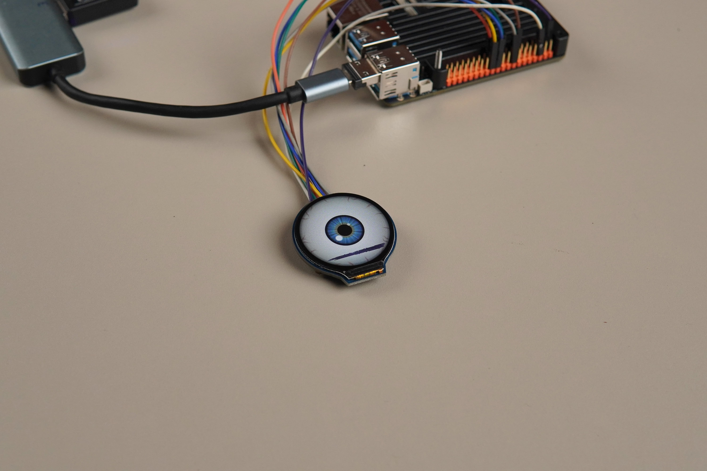

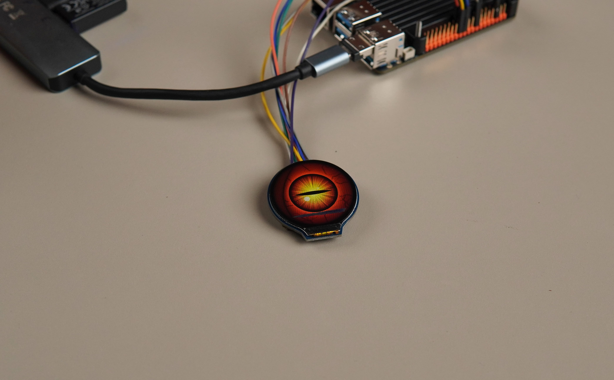

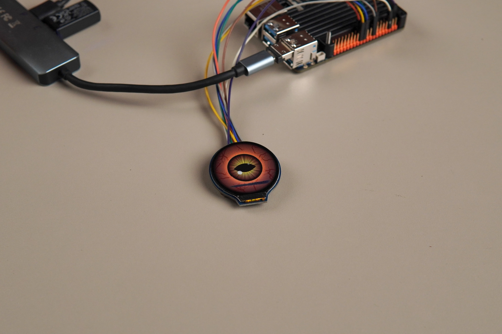

Three practical lessons came out of this chapter. Drawing all 402 frames takes a while on the X5, so each phase is cached in a `.eye_cache_<phase>.npy` file the first time, reloads in a moment, and re-renders automatically when `pumpkin_eye.py` changes. The scary frames change almost every pixel and take longer than a frame slot to send, so the player drops frames when it falls behind instead of slowing the animation down. And the display sits sideways in our pumpkin, so the frames are turned 90 degrees anticlockwise in software instead of fighting with the mounting.

```bash
python3 src/pumpkin_eye.py --mode normal       # the innocent eye
python3 src/pumpkin_eye.py --mode scary        # transform once, then the beast
python3 src/pumpkin_eye.py                     # all four phases in a loop
python3 src/pumpkin_eye.py --preview eye.gif   # render to a GIF, no display needed
```

### Chapter 3: A switch for the extras

A spooky pumpkin needs more than one eye. We wanted smoke drifting out of it at just the right moment, so we gave it a humidifier and let a relay on header pin 7 (kernel GPIO 420) switch it on and off. Its cool mist looks just like smoke. Pin 7 idles high at boot, so an active-low relay stays off until the code drives it.

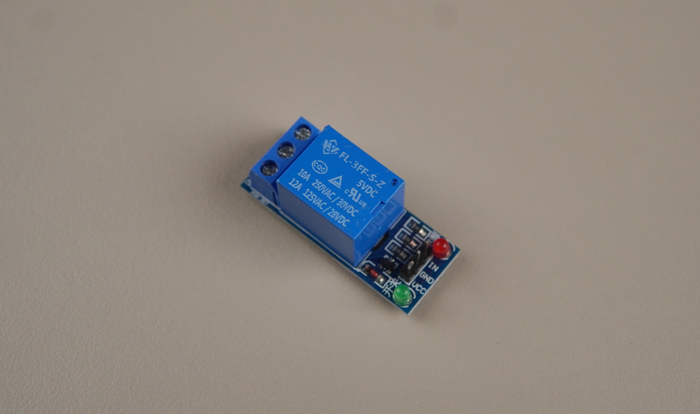

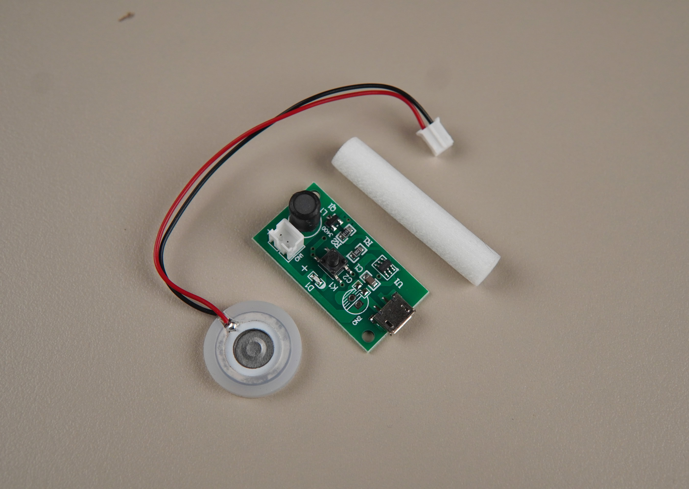

We drove it through Linux's sysfs GPIO interface rather than `Hobot.GPIO`, for one reason: the relay keeps its state after a command finishes, so we could flip it from the terminal while the pumpkin ran. `relay.py` turned into a tiny command-line tool.

It also gave us the shortest bug of the build. The first `status` check said OFF while the relay was clearly ON. Most cheap relay modules are active-low, switching on when their input is pulled to 0 V. One flag, `ACTIVE_LOW = True`, and `on` meant on.

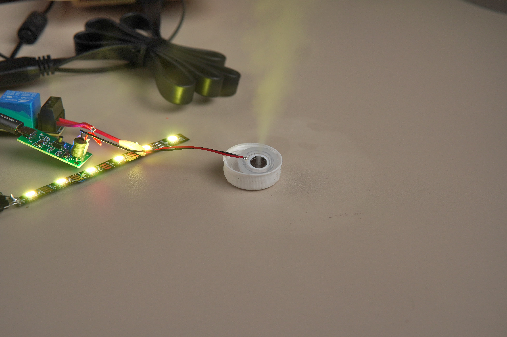

```bash
python3 src/relay.py on
python3 src/relay.py off
python3 src/relay.py toggle
python3 src/relay.py pulse 3    # on for 3 seconds, then off
python3 src/relay.py status
```

### Chapter 4: Teaching it to see

This is the chapter where the RDK X5 earned its place.

We found the TROS multitask model already on the board, loaded it with `hobot_dnn`, and tested it before the webcam was even plugged in, using the street photo that ships with it. Every frame has to be resized into the model's 960x544 input and converted to NV12, the colour format the BPU reads. We letterbox it rather than stretch it, so faces keep their shape. Out come three lists of boxes we care about, bodies, heads and faces, each with a confidence score.

Then the webcam went in, and we wired detection into the main program as a background thread. The camera never opened.

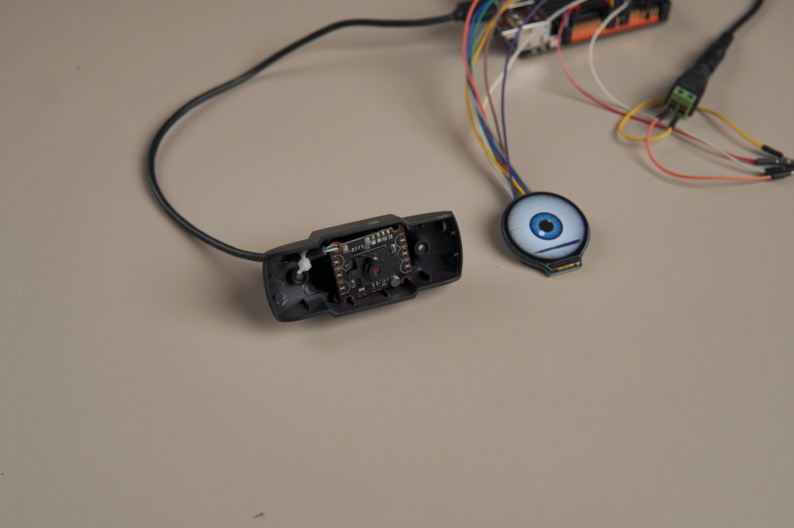

The culprit was hiding in the display code. While `spidev` sends a frame, it holds Python's global interpreter lock, and the eye sends frames nearly back to back. The camera thread almost never got a turn. We moved detection into its own process, on its own core, and it hung again, this time inside the BPU runtime: we had forked the process after OpenCV and the BPU had already started their own threads. Starting it fresh with `spawn` instead of `fork` finally gave us a camera, a BPU and an eye all running at once.

With it running, we stood in front of the camera and watched the numbers. At about a metre our faces were 104 to 145 pixels tall, with confidence from 0.81 to 0.99. That set the two thresholds that drive the whole show:

- **Someone is out there:** any body, head or face scoring 0.7 or more. This triggers the whisper.
- **Someone is right here:** a face at least 80 pixels tall, roughly within 1.5 metres. This triggers the scare.

Both must hold for two frames in a row, so a single stray detection never triggers anything. In the first test session alone, the pumpkin caught us and changed 21 times. If the camera is unplugged or stops delivering frames, the watcher keeps retrying until it comes back.

### Chapter 5: Finding its voice

Sound turned out to be the hardest part, and not for technical reasons. The X5 plays audio straight out of its 3.5 mm jack, and a few lines of Python (`sounds.py`) start each sound in its own small process group so audio never waits on the eye. It uses PulseAudio when a desktop session is running and falls back to ALSA otherwise. Finding sounds that were actually scary took far longer.

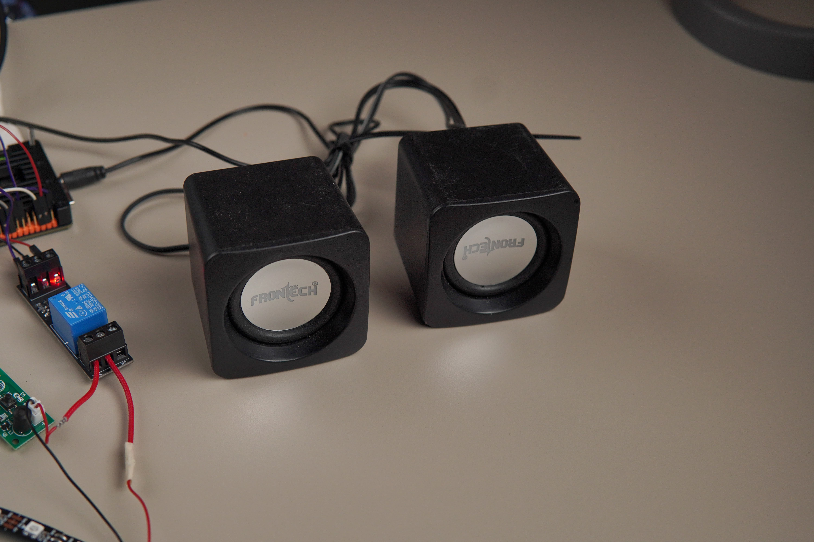

We began by generating everything in code: a dinosaur roar, a crack of thunder, howling wind, a droning chord and a slow heartbeat for the quiet moments. It worked, and it sounded like a computer pretending. The wind went first, because a pumpkin that howls all night while nobody is around is just noise. The roar went later.

For the far-away whisper we tried text-to-speech next, running the offline Piper engine on the X5 and layering it with whispers, echoes and reverb. Closer, but still not the voice we had in our heads: the slow, ghostly "I SEE YOU" from a sound effect by ALexis KB Sounds on YouTube. Rather than rip the video, we read its description, which credits Quick Sounds. The original is free there under a licence that asks for credit, so that is the one in the pumpkin.

The laugh took three rounds. Two public-domain cackles from OpenGameArt were too thin. A dozen witch and evil laughs from Quick Sounds' library, played back to back as a numbered audition, were not ghostly enough. The winner was ProSounds' "Ghost Laughing".

Then came the strangest bug of the build: the pumpkin scared people, and nobody heard the laugh. The first cause was timing. The laugh was queued after a five-second thunder-and-roar, and anything that ended the scare before then cut it off. So we dropped the roar and started the laugh the instant the scare begins, on its own player so nothing else can stop it. It was still silent. Measuring the file's loudness second by second exposed a fade-out in our conversion that started at second zero instead of the end, silencing all but the first instant. One fixed `ffmpeg` command later, the pumpkin finally laughed.

The sound plan we ended with:

- **Nobody around:** silence (or wind, drone and heartbeat with `--ambient`).
- **Someone far away:** "I see you...", at most once every 20 seconds, and never over the laugh.
- **The scare:** the ghost laugh, always played to the end, then a low growl that loops for as long as the scare is kept going.

### Chapter 6: Making it glow

A laugh in the dark is creepy. A laugh that lights up the inside of the pumpkin with every "ha" is better. We added a strip of five WS2812B LEDs and set ourselves one goal: the light should follow the laugh, not just switch on.

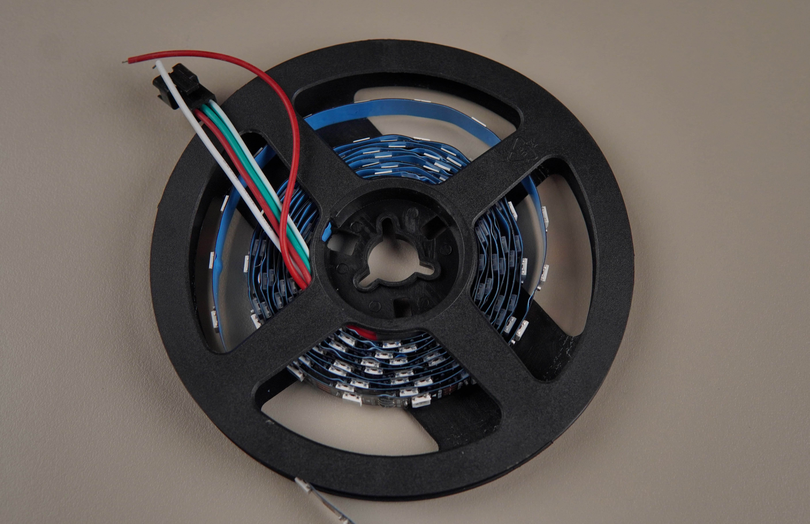

WS2812B LEDs listen to a single data wire and expect pulses timed to fractions of a microsecond. Linux cannot toggle a pin that precisely, but SPI hardware can. Our first version ran SPI at 2.4 MHz and sent each LED bit as three SPI bits, `100` for 0 and `110` for 1, the textbook trick.

The strip first lived on SPI2, which ships disabled, so we wrote a tiny device-tree overlay that flips it to `okay`, added it to `/boot/config.txt`, and rebooted. `/dev/spidev2.0` appeared. When the display moved to SPI2 (Chapter 1), the two swapped places, and the LEDs went to SPI1's data pin, header pin 19. The overlay stayed; it now powers the eye.

```dts
/dts-v1/;
/plugin/;
/ {
  fragment@0 {
    target-path = "/soc/a55_apb0/spi@34020000";
    __overlay__ { status = "okay"; };
  };
};
```

The software said everything worked. The strip said nothing at all. We joined the strip's power-supply ground to the board's ground. Still dark. We ran it from 3.3 V to rule out the signal level. Still dark. We ran a loopback test on the SPI controller, which passed inside the chip. And then, in the middle of all that testing, the LEDs lit up without a single change. A loose jumper was the most likely culprit, and it is the first thing we would check again.

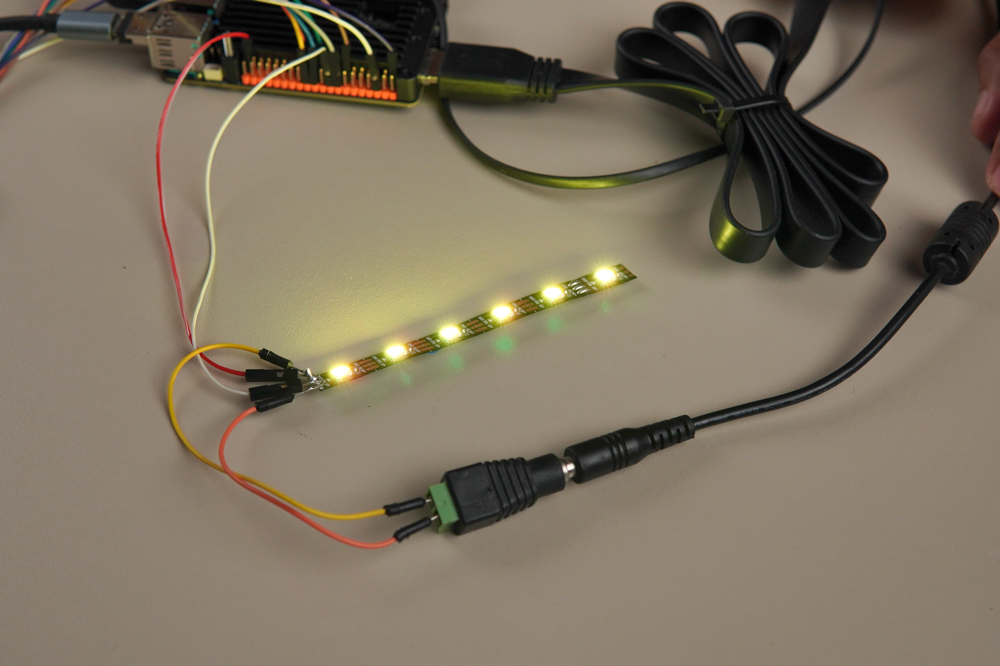

On SPI1 the strip had a new problem: LEDs that should be off showed white, and the rest showed random colours. SPI1's weak 1.8 V, 3 mA pad makes every high pulse fall slowly, so the strip read every 0 as a 1. The fix was a shorter 0 pulse. SPI now runs at 4 MHz, each SPI bit lasts 0.25 microseconds, and each LED bit becomes five SPI bits: `10000` (0.25 µs high) means 0 and `11100` (0.75 µs high) means 1. A 320 µs low gap before and after each update latches the colours, long enough for newer WS2812B chips, which need more than 280 µs.

The last touch was colour. Our first yellow had too little green and looked amber. Pure yellow on an RGB LED is red and green both at full, `(255, 255, 0)`, which is also the brightest yellow the strip can make.

To make the light follow the laugh, the LED process reads the laugh file once and turns it into a loudness curve, 50 values a second, with a fast attack and a slower release so the light breathes. When the laugh starts, the strip rides that curve: dark between breaths, blazing on each "ha", spreading outwards from the middle LEDs when the laugh is loudest, with a faint candle flicker on top.

```bash
python3 src/ws2812.py test       # a yellow dot runs along the strip, then all fade up and down
python3 src/ws2812.py hold 60    # all LEDs bright yellow for 60 seconds, handy for checking wires
python3 src/ws2812.py rgb        # solid red, green, blue for 5 seconds each: colour order and data check
python3 src/ws2812.py laugh      # the laugh with its lights
python3 src/ws2812.py off
```

### Chapter 7: The night it came together

With every part tested on its own, `pumpkin.py` only had to conduct the orchestra. Its main loop shows eye frames at 20 frames a second and, between frames, checks the two answers coming from the BPU process: is someone out there, and is a face close.

The integration still had one surprise. After a few happy minutes the program crashed with an `IndexError`. The whisper had fired on the very last frame of the normal eye loop, and in doing so skipped the step that wraps the animation back to frame one. We moved the whisper out of the animation logic entirely, and it never happened again.

The next time we started it, the pumpkin caught someone within ten seconds: first "I see you..." from across the room, then the full scare as they leaned in. This is what a close face sets off:

1. **0 s:** the ghost laugh starts, the LEDs flare yellow with it, the relay switches on the humidifier, and the eye begins to twitch.
2. **About 1.4 s:** the eyelids slam shut with a red flash.
3. **About 4 s:** the reptile eye opens and starts scanning.
4. **About 9.4 s:** the laugh ends, the LEDs go dark, and a low growl loops while the face stays close.
5. **4 s after they leave:** the eye blinks back to normal, the growl stops, and once the blink ends the humidifier switches off. The laugh is never cut off: if they leave early, it still plays to the end.

```bash
cd ~/Desktop/pumpkin
python3 src/pumpkin.py            # Ctrl+C stops it and switches everything off
python3 src/pumpkin.py --debug    # also prints every detection
```

Every pumpkin sits in a different doorway, so the important numbers are options:

| Option | Default | What it changes |
| --- | --- | --- |
| `--camera` | auto | Camera index or `/dev/videoN`; by default the first one that delivers frames |
| `--threshold` | 0.7 | Detection confidence needed |
| `--near-face` | 80 | Face height in pixels (of 480) that counts as close; raise it to scare only people right at the pumpkin |
| `--whisper-every` | 20 | Minimum seconds between "I see you" whispers |
| `--hold` | 4 | Seconds without a close face before the eye goes back to normal |
| `--rotate` | 90 | Turns the eye anticlockwise to match how the display is mounted |
| `--ambient` | off | Brings back the wind, drone and heartbeat while waiting |
| `--leds` | 5 | Number of LEDs; 0 disables the strip |
| `--led-offset` | 0.15 | Delays the lights so they line up with your speaker |
| `--mute` | off | No sound at all |
| `--debug` | off | Prints every detection with face heights |

## Wiring

Everything except the camera and speaker connects to the X5's 40-pin header. Pin numbers below are physical header pins (1 to 40), not GPIO numbers.

| Device | Device pin | RDK X5 header pin | Notes |
| --- | --- | --- | --- |
| Round display | VCC | 17 (3.3 V) |  |
| Round display | GND | 20 |  |
| Round display | GND (second) | 30 | Next to SCLK, helps against glitches |
| Round display | DIN | 18 (SPI2 MOSI) | Keep this wire short |
| Round display | CLK | 29 (SPI2 SCLK) | Keep this wire short |
| Round display | CS | 31 (SPI2 CS, `/dev/spidev2.0`) |  |
| Round display | DC | 22 | GPIO |
| Round display | RST | 13 | GPIO |
| Round display | BL | 15 | Backlight, GPIO |
| WS2812B strip | DIN | 19 (SPI1 MOSI, `/dev/spidev1.0`) | Wire to the end the arrows point away from |
| WS2812B strip | 5V | External 5 V supply + | 5 LEDs at full yellow draw about 200 mA |
| WS2812B strip | GND | Supply GND and header pin 25 | Grounds must be joined |
| Relay module | IN | 7 (GPIO 420) | Active-low: LOW switches it on |
| Relay module | VCC / GND | 4 (5 V) / 6 | Check your module's voltage |
| Speaker | 3.5 mm plug | Headphone jack |  |
| Webcam | USB | Any USB 3.0 port | Shows up as `/dev/video0` |

Leave header pins 21, 23, 24, 26 and 37 empty. They belong to the two SPI buses.

## Assembly

The pumpkin is printed in four parts: the face with the eye hole, the nose and the grin, two shell pieces that make up the back, and a lid with a curled stem.


The eye goes in first. The round display sits in a printed holder right behind the eye hole, and the webcam's board is mounted on the inside of the face just below it, so the camera sees what the eye appears to be looking at.

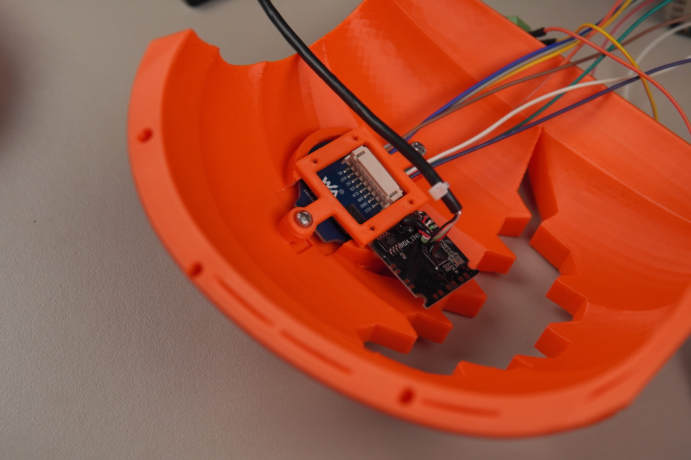

Next comes the brain. The RDK X5, in its heatsink case, goes inside the shell, with the relay and the wiring for the display, the LEDs and the mist module around it.

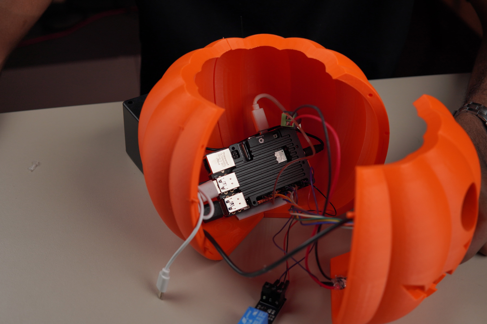

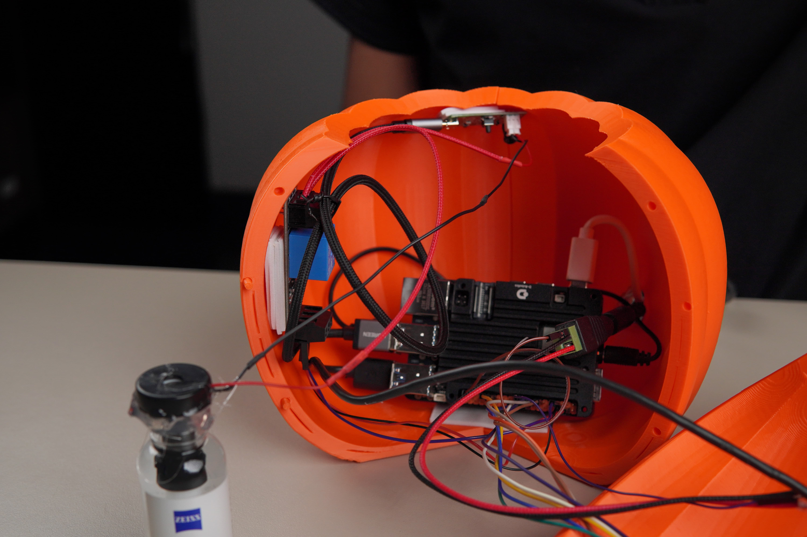

The two back pieces close around the electronics. With the lid off there is still a way in for adjusting wires or the mist module.

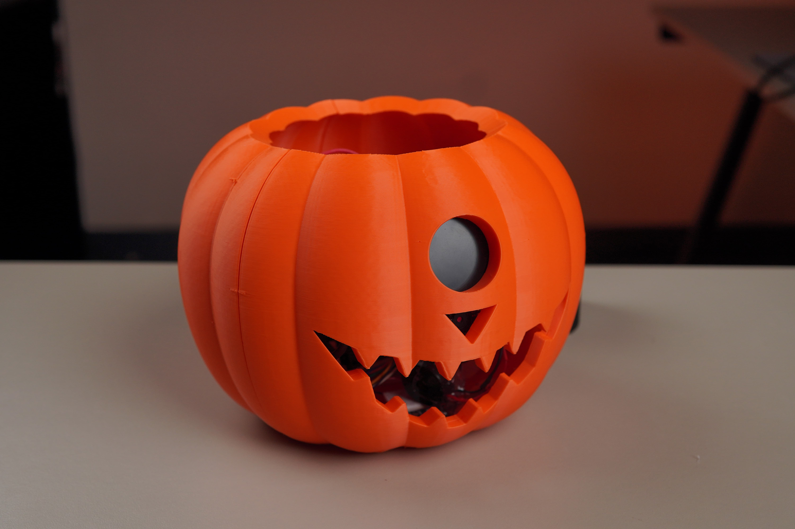

The lid and stem go on last, and the Cyclops is ready to wake up.


## Setup and Run

You need an RDK X5 running the Ubuntu 22.04 image with TROS installed, which brings hobot_dnn and the face model with it. From there it is seven steps.

1. **Wire it up** using the table above, then **assemble** it as shown in Assembly. Keep the SPI wires short.
2. **Get the code** onto the board, into `~/Desktop/pumpkin`.
3. **Check the Python packages.** The code needs NumPy, OpenCV, spidev and Hobot.GPIO (Pillow only for `--preview`), plus ffmpeg (for `ffprobe`) and PulseAudio or ALSA. Install any that are missing.
4. **Enable SPI2** with the overlay in `overlay/dtoverlay_spi2_ws2812.dts` (Chapter 6 shows how), then reboot and check that both `/dev/spidev1.0` and `/dev/spidev2.0` exist.
5. **Add the sounds.** The two credited sound effects are not included in the repository. Download them from Quick Sounds and ProSounds, and save them as `sounds/iseeyou.wav` and `sounds/laugh.wav`.
6. **Test each part on its own, then wake the pumpkin.**
7. **Optional: start on boot** with `pumpkin.service` (see below).

```
python3 src/pumpkin_eye.py --mode normal   # display: the moving eye
python3 src/relay.py pulse 3      # relay: on for 3 seconds
python3 src/ws2812.py test        # LEDs: a yellow dot runs along the strip
python3 src/pumpkin.py --debug    # the whole pumpkin, printing every detection
```

The options table in Chapter 7 covers tuning the pumpkin for your doorway.

### Start on boot

`pumpkin.service` runs `src/pumpkin.py` under systemd as the `sunrise` user from `/home/sunrise/Desktop/pumpkin`, waits up to 60 seconds for PulseAudio, and restarts the program if it ever exits. Edit `User`, `Group`, `WorkingDirectory` and `ExecStart` if your user or folder differ, then:

```bash
sudo cp pumpkin.service /etc/systemd/system/
sudo systemctl daemon-reload
sudo systemctl enable --now pumpkin.service
journalctl -u pumpkin -f      # watch its output
```

## Code

Everything is plain Python 3.10, one file per part, and the repository holds only what the pumpkin needs to run. Most parts can also be run on their own for testing.

```text
pumpkin/
├── src/                 the pumpkin: everything needed at runtime
├── sounds/              iseeyou.wav, laugh.wav (download), growl.wav, ambience.wav, CREDITS.txt
├── overlay/             device-tree overlay that enables SPI2
├── assets/              photos and the architecture diagram
└── pumpkin.service      systemd unit for start on boot
```

| File | Part | Run it alone |
| --- | --- | --- |
| `src/pumpkin.py` | Main program: state machine, BPU watcher process, LED process | `python3 src/pumpkin.py` |
| `src/gc9a01.py` | Round display driver (SPI2 + GPIO, changed-band updates) | imported |
| `src/pumpkin_eye.py` | Procedural moving eye, four phases, frame cache, frame clock | `python3 src/pumpkin_eye.py --mode scary` |
| `src/relay.py` | Relay on pin 7 (active-low, sysfs) | `python3 src/relay.py on` |
| `src/sounds.py` | Background sound playback (PulseAudio or ALSA) | imported |
| `src/ws2812.py` | WS2812B over SPI1 + laugh lights | `python3 src/ws2812.py test` |
| `overlay/dtoverlay_spi2_ws2812.dts` | Device-tree overlay that enables SPI2 (now for the display) | see Chapter 6 |
| `pumpkin.service` | systemd unit for start on boot | see Setup and Run |
| `sounds/` | `iseeyou.wav`, `laugh.wav`, `growl.wav`, `ambience.wav` and credits |  |

### The heart of the detection

```python
def detect(self, bgr):
    """Return (number of people-ish detections, face heights in camera pixels)."""
    nv12, scale = to_nv12(bgr)                 # letterbox 640x480 into 960x544 NV12
    outs = self.model.forward(nv12)            # one BPU pass, ~13 ms

    def boxes(idx):
        rows = outs[idx].buffer.reshape(-1, 6)  # [x1, y1, x2, y2, score, cls], padded with -1
        return rows[rows[:, 4] >= self.threshold].copy()

    faces = boxes(FACE_OUTPUT)
    people = len(boxes(BODY_OUTPUT)) + len(boxes(HEAD_OUTPUT)) + len(faces)
    return people, (faces[:, 3] - faces[:, 1]) / scale
```

### WS2812B timing from SPI

```python
SPI_HZ = 4_000_000
SPI_BITS = 5   # SPI bits per LED bit

def _lut():
    lut = np.zeros((256, SPI_BITS), np.uint8)
    for v in range(256):
        bits = 0
        for i in range(7, -1, -1):
            bits = (bits << SPI_BITS) | (0b11100 if (v >> i) & 1 else 0b10000)
        lut[v] = np.frombuffer(bits.to_bytes(SPI_BITS, "big"), np.uint8)
    return lut
```

Each colour byte becomes five SPI bytes through this lookup table, so a full 5-LED update is 75 bytes framed by two 160-byte reset gaps, and takes well under a millisecond.

## Troubleshooting

Every problem below happened to us while building this pumpkin.

| Symptom | Cause | Fix |
| --- | --- | --- |
| Display backlight on, picture blank | Wrong chip select for the `spidev` device | On SPI2 use `/dev/spidev2.0` with CS on pin 31 (on SPI1, pin 24 is CS1 = `spidev1.1`) |
| Display shows random glitches | SPI1's pads are 1.8 V / 3 mA, too weak for jumper wires | Use SPI2 (3.3 V / 9 mA pads), keep wires short, add the second GND on pin 30 |
| Camera never opens when run with the display | SPI holds Python's GIL, starving a thread | Run detection in its own process |
| Detection process hangs at start | `fork` after the BPU runtime has loaded | Start processes with `spawn` |
| Relay on when it should be off | Module is active-low | `ACTIVE_LOW = True` in `relay.py` |
| A sound plays but is silent | Bad fade in the conversion | Check the file's loudness per second, re-convert |
| Program crashed with `IndexError` | A whisper fired on the last eye frame and skipped the loop-around | Fixed: the whisper sits outside the frame logic |
| LED strip completely dark | Loose connection, ungrounded supply, or the strip wired from its DOUT end | Join grounds, feed DIN, press jumpers in, test with `ws2812.py hold` |
| LEDs white or random colours | Slow falling edges on SPI1 turn 0 bits into 1s | Short 0 pulse: 5 SPI bits per LED bit at 4 MHz (default); check with `ws2812.py rgb` |
| No `/dev/spidev2.0`, display won't start | SPI2 overlay not loaded | Check `/boot/config.txt` ends with an empty line, reboot |

Two lessons worth more than any single fix:

- **Test every part alone first.** Each tool in this project (`pumpkin_eye.py`, `relay.py`, `ws2812.py test`) exists so a fault can be pinned to one part in a minute.
- **Measure, don't guess.** A per-second loudness check found the silent laugh; reading the pad configuration explained the display glitches and the white LEDs.

## Known Limitations and Safety

Every monster has its weaknesses, and the Cyclops is no exception.

### Limitations

- **It needs some light to see.** The webcam and the face model work on ordinary camera frames, so a pitch-dark doorway leaves the pumpkin half-blind. A porch light or a lamp nearby helps.
- **"Close" is tuned for our camera.** 80 pixels of face height means roughly 1.5 metres with our webcam at 640x480. A different camera or doorway needs a new `--near-face` value.
- **The scary eye drops frames.** SPI2 manages about 14 full frames a second, so frames that change almost every pixel cannot keep up with 20 frames a second and some are skipped.
- **The eye does not follow you yet.** It glances around on its own path, even after it has spotted someone.
- **Two sound effects are not included** in the repository and have to be downloaded separately.

### Safety

- **Power the LEDs from their own 5 V supply** and join its ground to the board's ground, as in the wiring table.
- **Keep mains away from the pumpkin.** If your humidifier runs on mains power, use a relay module rated for that load and keep all mains wiring enclosed.
- **Moving parts.** The robot moves through its eye on the display and the mist from the relay-switched humidifier; there are no motors or pinch points. Mount the display and humidifier firmly so nothing can tip over.
- **Keep the mist away from the electronics.** Point the humidifier's outlet away from the X5, the display and the LED wiring.
- **Mind the volume around small children.** The laugh is loud up close. Lower the speaker or use `--mute`.
- **Nothing leaves the board.** Camera frames are processed on the X5 and nothing is sent anywhere.

## What's Next

The pumpkin works, but the X5 is barely breaking a sweat, and we already have a list for next October.

- **A hidden camera.** Swap the webcam for a small MIPI CSI camera on one of the X5's two camera ports.
- **An eye that follows you.** The BPU already gives each face's position; feeding it to the iris would make the eye track whoever is closest.
- **More voices.** Different lines for repeat visitors, or for groups versus a single person.

What started as a joke about a pumpkin that looks back became a small lesson in edge AI: a camera, a neural network, a display, a speaker and a strip of lights, all reacting to a person in real time on one board, with nothing sent anywhere. Halloween just happened to be the perfect excuse.

Do you want to build your own? Everything you need is in the sections above: the parts, the wiring and the code. Start with Chapter 1, test each part on its own, and let us know what your pumpkin sees.

## License

The code is released under the [MIT License](LICENSE). The two sound effects keep their own licences and are not part of the repository.

Built with ❤️ by CodersCafeTech.
